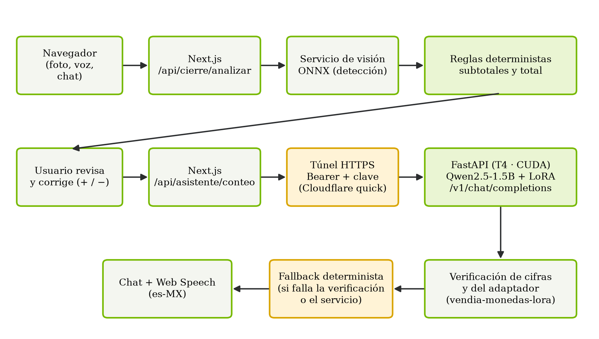

# Arquitectura

Conexión entre Next.js, Supabase, ONNX, FastAPI, Qwen y NVIDIA.



```text
Navegador ──► Next.js ──► Servicio de visión (FastAPI + ONNX, CPU)
   │             │  └──► Supabase (Auth, PostgreSQL, RLS)
   │             └──► [túnel HTTPS + Bearer] ──► FastAPI (Tesla T4, CUDA) ──► Qwen2.5-1.5B + vendia-monedas-lora
   └── Web Speech API (voz en el navegador)
```

## Componentes

| Componente | Dónde corre | Función |
|---|---|---|
| Next.js 16 (App Router) | Producción: K3s; local: `npm run dev` | Interfaz, rutas `/api/*` y verificación de sesión. Todas las claves se leen aquí, en el servidor. |
| Servicio de visión (`vision/`) | Pod `vision` (CPU) | `POST /contar-monedas` con el modelo ONNX; devuelve cuatro enteros. |
| Supabase | Proyecto Supabase | Auth por correo, conteos, cajas, memoria del asistente y cobros; RLS activo. |
| Servicio del asistente (`asistente/servicio_monedas.py`) | Laboratorio NVIDIA (Tesla T4) | `POST /v1/chat/completions` y `GET /salud`; Qwen2.5-1.5B-Instruct + `vendia-monedas-lora` en CUDA. |
| Túnel Cloudflare | Laboratorio → internet | Expone solo `127.0.0.1:8001`. |
| Web Speech API | Navegador | `speechSynthesis` en es-MX para «Escuchar resultado». |

## Flujo de una consulta

1. El navegador envía la foto a `/api/cierre/analizar`; Next.js valida (imagen, ≤ 10 MB, límite por IP) y la reenvía a `{VISION_API_URL}/contar-monedas`.
2. ONNX devuelve las cantidades por denominación. **El código calcula subtotales y total** con reglas deterministas; el usuario revisa y puede corregir.
3. `/api/asistente/conteo` recibe solo las cantidades y una pregunta opcional (≤ 240 caracteres); el servidor recalcula los importes.
4. Si `CIERRE_CHAT_URL` está definido, Next.js llama al servicio del asistente con `Authorization: Bearer`. El modelo solo redacta los hechos verificados.
5. La aplicación comprueba que el servicio declare `adaptador = vendia-monedas-lora` y que cada cifra y afirmación coincidan con los hechos.
6. Si algo falla (servicio caído, tiempo agotado, respuesta no verificable), muestra el **resumen determinista** calculado por código, etiquetado como tal.
7. El mensaje aparece en el chat; el usuario puede preguntar más y reproducirlo con la Web Speech API.

## Autenticación y secretos

- Sesiones con Supabase Auth; los datos están ligados a `user_id` con RLS. Los invitados guardan sus datos solo en `sessionStorage` de la pestaña.
- El servicio del asistente exige `Authorization: Bearer <clave>` en `/salud` y `/v1/chat/completions` (sin clave: 401). La clave solo existe en el servidor (Secret `hackathon-env` en producción, `.env.local` en local).
- `SUPABASE_SERVICE_ROLE_KEY`, claves de Stripe y `CIERRE_CHAT_KEY` nunca llegan al navegador.
- En producción, Cloudflare Access protege el hostname (ver `deploy/README.md`) y una `NetworkPolicy` limita el tráfico del pod de visión.

## Manejo de errores

| Fallo | Comportamiento |
|---|---|
| Imagen inválida o > 10 MB | Mensaje específico (400/413); no se guarda nada. |
| Servicio de visión caído o sin conexión | Mensaje distinto del de «sin monedas»; se puede reintentar. |
| Cero monedas detectadas | Orientación al usuario; no se ofrece guardar un conteo vacío. |
| Asistente caído, sin respuesta en 25 s o respuesta no verificable | Resumen determinista con las mismas cifras. |
| Navegador sin `speechSynthesis` | Aviso; el resto funciona. |

## Limitación: túnel temporal NVIDIA

Mientras `CIERRE_CHAT_URL` apunte a un túnel `trycloudflare.com` («quick tunnel»), la conexión **no tiene garantía de disponibilidad**: la URL cambia en cada arranque y desaparece al cerrar `cloudflared` o al caducar el laboratorio DLI, que es efímero. En la última comprobación documentada el laboratorio y el túnel ya no respondían, por lo que la aplicación funciona con el resumen determinista hasta restaurar el servicio (`03_ejecucion.md`). Una solución estable requeriría un túnel con nombre o un servidor propio con GPU.
