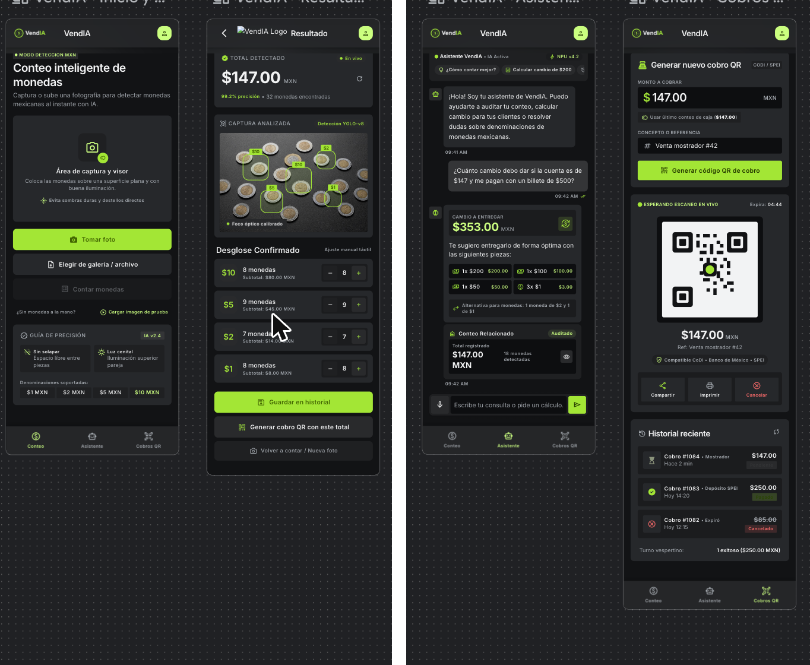
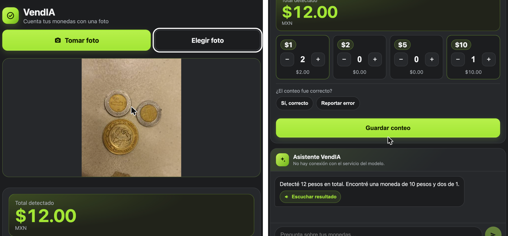
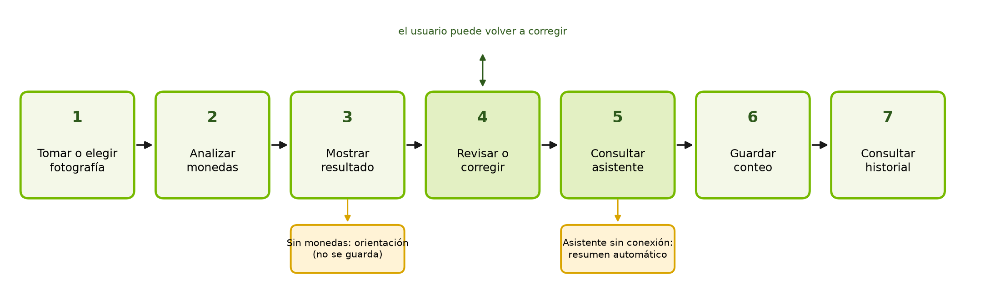
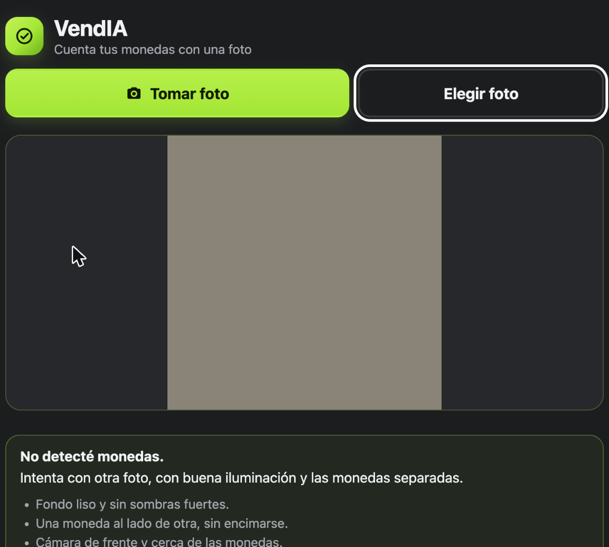

# Interfaz, HCI y criterios de aceptación

Documento HCI de VendIA para el hackathon NVIDIA Oaxaca 2026. Distingue lo **diseñado** (Google Stitch) de lo **implementado** (producción, `https://nvidia.addydx.com`). Las capturas son reales, tomadas el 20-nov-2026; los resultados de pruebas son observaciones de esa fecha.

## 1. Introducción

**VendIA** es una aplicación web móvil que cuenta monedas mexicanas de $1, $2, $5 y $10 a partir de una fotografía (visión por computadora) y un asistente conversacional (Qwen ajustado con LoRA) que explica el resultado. **Problema:** contar monedas a mano al cerrar el puesto es lento y propenso a errores de suma. **Público objetivo:** vendedores ambulantes y pequeños comercios que cobran en efectivo (`Docs/2_propuesta.md`). **Objetivo de la interfaz:** que una persona con poca experiencia técnica obtenga un total confiable en pocos pasos, pueda revisarlo y corregirlo, y entienda qué ocurrió cuando algo falla.

## 2. Análisis del usuario

| Aspecto | Descripción |
|---|---|
| Necesidad | Saber cuánto efectivo hay y guardarlo, sin errores y rápido, en el teléfono. |
| Proceso manual | Separar por denominación → contar cada pila (4 conteos) → calcular 4 subtotales → sumar el total → anotarlo. |
| Dificultades | Errores de conteo y suma, tiempo, pérdida de la anotación, repetir el cálculo si se corrige un dato. |
| Con VendIA | Tomar o elegir foto → revisar total y cantidades (corregir con − y +) → guardar. El asistente explica el resultado. |
| Paso que se mejora | El conteo y la suma: los hace el sistema; el usuario solo verifica. |

## 3. Diseño de interfaz

**Herramienta.** Los prototipos se hicieron en Google Stitch (proyecto «VendIA Coin Counter Web»): cuatro pantallas móviles — Inicio, Resultado, Asistente y Cobros QR. La figura 1 es una captura real del proyecto.

**Diseño responsive y móvil.** La implementación usa una columna de 480 px máximo (720 px en pantallas ≥ 900 px), botones principales de 56 px de alto y controles de ≥ 40 px y el campo del chat siempre visible. **Paleta NVIDIA** (variables CSS de `src/app/globals.css`): fondo carbón `#1c1d1f`, tarjetas `#26282b`, verde lima `#a3e635` (degradado `#b6f04a`→`#a3e635`) para acciones y total, rojo `#ff6b6b` para errores y texto `#f2f3f4`. **Tipografía:** pila de sistema (`system-ui`), sin fuentes externas. **Organización:** encabezado → tomar/elegir foto → fotografía → total y denominaciones editables → valoración → «Guardar conteo» → chat del asistente → historial plegable.

### Diseño frente a implementación

| Elemento | Stitch (propuesta) | Producción (implementado) |
|---|---|---|
| Estructura | 4 pantallas con barra inferior (Conteo, Asistente, Cobros QR) | Una pantalla; el asistente va debajo del resultado; cobros en una ruta aparte (`/cobrar`) |
| Resultado | Total arriba, foto con cajas de detección y desglose | Foto, total destacado y denominaciones; **sin cajas dibujadas sobre la foto** |
| Asistente | Pantalla propia con cálculo de cambio y billetes | Chat integrado que explica solo el conteo; **no calcula cambio** |
| Extras del prototipo | «Cargar imagen de prueba», guía de precisión, porcentaje de precisión | No implementados |
| Corrección | Botones − / + por denominación | Igual, más campo numérico editable |
| Guardado | «Guardar en historial» | «Guardar conteo» e historial plegable |

## 4. Flujo de interacción

## 5. Decisiones de diseño

| Decisión | Justificación | Cómo mejora la interacción |
|---|---|---|
| **La fotografía como elemento principal** | «Tomar foto» y «Elegir foto» son los primeros controles; la foto ocupa el ancho de la tarjeta. | El usuario ve de inmediato qué se analizó y puede comparar la imagen con el resultado. |
| **Total destacado con verde NVIDIA** | El importe va en tipografía grande sobre un panel con degradado verde y contraste alto sobre fondo carbón. | La cifra que importa se lee de un vistazo, incluso con poca luz o al aire libre; el verde marca lo principal y el rojo, lo erróneo. |
| **Conteo editable y asistente debajo del resultado** | Cada denominación tiene − / + y campo numérico; al corregir, el total y la explicación se actualizan; el chat está en la misma pantalla. | Las bases exigen revisar y corregir lo que interpreta la IA antes de confirmar. Sin cambiar de pantalla, el usuario corrige, pregunta y guarda. |
| **Estados y errores explícitos** (apoyo) | Indicadores «Analizando foto…» y «Generando explicación…», y mensajes distintos para imagen inválida, sin monedas y fallo de servicio. | El usuario sabe qué ocurre y qué hacer; un error no se confunde con «sin monedas». |

## 6. Criterios de aceptación

Estado: **Comprobado (prod.)** = observado en producción el 20-nov-2026; **Comprobado (local)** = observado en desarrollo local en esta sesión de trabajo, no repetido en producción; **No comprobado**.

| ID | Funcionalidad | Condición inicial | Acción del usuario | Resultado esperado | Estado comprobado |
|---|---|---|---|---|---|
| CA-01 | Fotografía | Pantalla principal | Elegir una foto de monedas | La foto se muestra y se analiza automáticamente | Comprobado (prod.) |
| CA-02 | Detección | Foto cargada | Esperar el análisis | Total y cantidades por denominación | Comprobado (prod.): $12.00 (1 × $10 + 2 × $1); exactitud frente a la realidad no verificada |
| CA-03 | Corrección | Resultado visible | Pulsar + en $5 | Total y explicación se actualizan | Comprobado (prod.): $12.00 → $17.00 |
| CA-04 | Chatbot | Resultado visible | Preguntar «¿Cuánto suman las monedas de 10 pesos?» | Respuesta con cifras verificadas | Comprobado (prod.) con resumen automático: «suman 10 pesos». Respuesta del modelo Qwen: no comprobada hoy (sin conexión al laboratorio) |
| CA-05 | Voz | Mensaje del asistente | «Escuchar resultado» y luego «Detener» | La lectura empieza y se detiene desde el mismo botón | Comprobado (prod., Brave) |
| CA-06 | Guardado | Conteo válido | «Guardar conteo» | Se guarda y aparece como último conteo | Comprobado (local, invitado); no repetido en producción para no alterar datos de la cuenta |
| CA-07 | Historial | Dos o más conteos guardados | Abrir «Historial» | Lista de conteos anteriores | Comprobado (local, invitado) |
| CA-08 | Errores | Imagen inválida / foto sin monedas / asistente sin conexión | Subir un `.txt`; subir una foto lisa; preguntar con el modelo apagado | Mensaje específico, sin guardar un conteo vacío, con respaldo | Comprobado (prod.) los tres; fallo del servicio de visión: no comprobado |

## 7. Pruebas funcionales

| Caso | Entrada | Resultado esperado | Resultado obtenido | Estado |
|---|---|---|---|---|
| P1 Fotografía válida | Foto de 3 monedas | Total y cantidades | $12.00: 2 × $1 y 1 × $10 | Aprobada (ejecución); exactitud no verificada |
| P2 Imagen inválida | Archivo de texto | «Elige un archivo de imagen.» | Ese mensaje; el conteo anterior no cambió | Aprobada |
| P3 Sin detecciones | Imagen gris lisa | Orientación; sin opción de guardar | «No detecté monedas…» con tres consejos; no aparece «Guardar conteo» | Aprobada |
| P4 Corrección | Pulsar + en $5 | Total y explicación actualizados | $17.00 y «Con tu corrección, el total es de 17 pesos…» | Aprobada |
| P5 Preguntas al asistente | «¿Cuánto suman las monedas de 10 pesos?» | Respuesta verificada y etiquetada | «Las monedas de 10 pesos suman 10 pesos.» (Resumen automático) | Aprobada con respaldo; no valida al modelo |
| P6 Fallo de inferencia | Modelo del laboratorio apagado | Aviso y respuesta de respaldo | Estado «No hay conexión con el servicio del modelo.» y resumen por código | Aprobada |
| P7 Guardar y recuperar | «Guardar conteo» y consultar | Último conteo e historial | Verificado en local (invitado) | Aprobada (local) |

No se probó el fallo del servicio de visión ni el guardado en una cuenta en producción.

## 8. Evaluación de usabilidad

**Estado: pendiente.** No se han realizado pruebas con personas ajenas al equipo, por lo que no se registran participantes ni respuestas. Protocolo (≥ 2 personas ajenas; si no son vendedores, anotar esa limitación; su participación no es asesoría para el desarrollo).

| Campo | Participante A | Participante B |
|---|---|---|
| Perfil general (edad, ocupación, experiencia con apps; ¿cuenta efectivo?) | Pendiente | Pendiente |
| Tarea solicitada | Contar las monedas de una mesa con VendIA, corregir un dato y guardar | Igual |
| Tiempo y pasos hasta guardar | Pendiente | Pendiente |
| Dificultades observadas | Pendiente | Pendiente |
| Comentarios | Pendiente | Pendiente |
| Mejoras realizadas | Pendiente | Pendiente |

## 9. Comparación y resultados

| Medida | Conteo manual | VendIA | Cómo se obtuvo |
|---|---|---|---|
| Pasos hasta el total | 5 (separar, contar 4 pilas, calcular subtotales, sumar, anotar) | 3 interacciones (foto, revisar, guardar) | Definidos por el equipo a partir de los flujos de las secciones 2 y 4 |
| Tiempo de análisis | No medido | 407–579 ms (5 llamadas a `/api/cierre/analizar` con una imagen de 480 × 640, producción) | Medición directa; solo servicio y red, no incluye tomar la foto |
| Errores | No medidos | Sin medición de exactitud | Requiere fotos con conteo conocido |

Limitaciones: los pasos son una comparación de diseño, no un cronometraje; la latencia se midió con una imagen sin monedas, no con fotos reales. Por no existir mediciones comparables de tiempo ni de errores, **no se incluye gráfica**.

## 10. Conclusiones

La interfaz reduce el conteo a tres interacciones, mantiene al usuario en control (revisar y corregir antes de guardar) y comunica estados y errores de forma distinguible. Comprobado en producción: foto, detección, corrección, preguntas con respaldo, voz y tres casos de error. **Evidencias que faltan:** pruebas de usabilidad con dos personas ajenas, exactitud de la detección con conteos conocidos, tiempo manual frente a digital, guardado en cuenta en producción y respuesta del modelo Qwen desde producción (el túnel temporal al laboratorio NVIDIA no estaba disponible). **Mejoras posibles:** cajas de detección sobre la foto (previstas en Stitch), cálculo de cambio (prototipo, no implementado) y almacenamiento persistente de la valoración del conteo.
